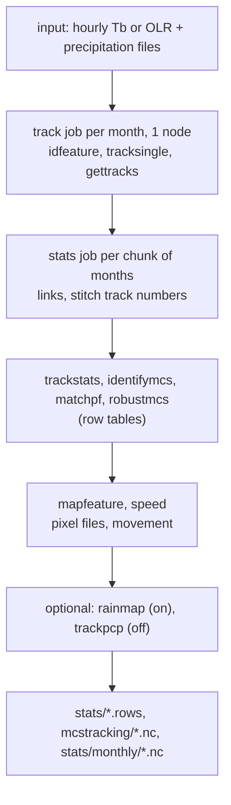

# The Tb+PF MCS tracking workflow: how to use it

How to run MCS tracking from brightness temperature (Tb) and precipitation (PF), `feature_type: tb_pf`, with the unified run script
[run_mcs_tbpf_unified.py](../runscripts/run_mcs_tbpf_unified.py): for one period, for a campaign of months or a year (one job per month for the
first three steps, one stitched job for the rest), with row-table statistics, output checks, optional monthly rain maps and optional per-track
precipitation accumulation. It is the Tb+PF version of the workflow of the radar pipeline (`run_mcs_radar3d.py`); the stitching is described in
[stitching.md](stitching.md), the row tables in [rowstats.md](rowstats.md), the precipitation along the tracks in
[track_precipitation.md](track_precipitation.md). The worked example is the E3SM ne120 simulation on a 0.1 degree global grid
([The E3SM example](#the-e3sm-example-01-degree-global-hourly)).

## Which script, which MCS definition

**Use `run_mcs_tbpf_unified.py` for new work.** It replaces the `run_mcs_tbpf*.py` scripts (they stay as they are for old workflows): the steps and
the outputs are the same, the differences between the old scripts are config keys. The one choice that changes the MCSs you get is the definition of
the robust MCS, and it is a required key without a default, so it is always written down in the config:

```yaml
robustmcs_definition: mcsmip      # or feng21
```

| | `mcsmip` | `feng21` |
|---|---|---|
| origin | MCSMIP / SAAG ([robustmcspf_saag.py](../pyflextrkr/robustmcspf_saag.py)) | Feng et al. (2021) ([robustmcspf.py](../pyflextrkr/robustmcspf.py)) |
| PF major axis | between `mcs_pf_majoraxis_thresh` and `max_pf_majoraxis_thresh` for at least `mcs_pf_durationthresh` hours (gaps up to `mcs_pf_gap`) | the same |
| rain | the largest PF maximum rain rate above `heavy_rainrate_thresh` for at least `mcs_pf_durationthresh` hours, and the total rain volume above `mcs_min_rainvol_thresh` for at least `mcs_volrain_duration_thresh` hours | the PF area, the PF mean rain rate and the PF rain rate skewness above values that grow linearly with the duration (`coefs_pf_area`, `coefs_pf_rr`, `coefs_pf_skew`) for at least `mcs_pf_durationthresh` hours, and the heavy rain share of the volume above a value that grows with the duration (`coefs_pf_heavyratio`) |
| keys | `mcs_min_rainvol_thresh`, `mcs_volrain_duration_thresh`, `heavy_rainrate_thresh` | `coefs_pf_area`, `coefs_pf_rr`, `coefs_pf_skew`, `coefs_pf_heavyratio` |
| fitted to a data set | no: simple thresholds | yes: the coefficients of [config_imerg_mcs_tbpf_example.yml](../config/config_imerg_mcs_tbpf_example.yml) are fitted to IMERG |
| used by | the IMERGv7 reference config and the E3SM template of this workflow | `run_mcs_tbpf.py`, `run_mcs_tbpf_wrf.py`, `run_mcs_tbpf_gpm.py` and their configs |

Both definitions need the same earlier steps and give the same files; only `pf_mcsstatus`, `pf_lifetime` and the selection of the tracks differ. Take
`mcsmip` to compare with MCSMIP results or to track a model without a fit of the coefficients; take `feng21` to repeat the criteria of the earlier
Tb+PF tracking of observations. If `run_robustmcs` is on and the key is missing or wrong, or a key of the definition is missing, the run stops at its
start with a message that names both options, the old scripts each one replaces and the keys each one needs.

**What replaces the other differences of the old scripts**

| old script | what it did | in the unified script |
|---|---|---|
| `run_mcs_tbpf.py` | Feng21 definition, optional HEALPix remapping | `robustmcs_definition: feng21`, `run_remap_healpix` |
| `run_mcs_tbpf_mcsmip.py` | MCSMIP definition, HEALPix remapping, Dask timeouts | `robustmcs_definition: mcsmip`, `run_remap_healpix`, the keys `timeout` and `nprocesses` |
| `run_mcs_tbpf_saag.py` | WRF preprocessing, MCSMIP definition, regridding of the mask | `robustmcs_definition: mcsmip`, `run_preprocess`, `run_regrid_mask` |
| `run_mcs_tbpf_wrf.py` | WRF preprocessing, Feng21 definition, regridding of the mask | `robustmcs_definition: feng21`, `run_preprocess`, `run_regrid_mask` |
| `run_mcs_tbpf_gpm.py` | the year added to `clouddata_path` and `tracking_outpath` in the script | `clouddata_subdir_format: '%Y'` and a `root_path` (or `tracking_path_name`) per year |
| `run_mcs_tb.py`, `run_mcs_tbpfradar3d.py`, `run_mcs_tbpfradar3d_wrf.py` | Tb only, Tb + radar | not covered: they stay as they are |

## The defaults of this workflow

| | decision | where it is |
|---|---|---|
| MCS definition | **explicit**: `robustmcs_definition` is required (`mcsmip` or `feng21`), no default | [Which script, which MCS definition](#which-script-which-mcs-definition) |
| statistics format | **`stats_format: rows`** in the templates of this workflow: the files of identifymcs, matchpf, robustmcs and speed are row tables (`mcs_tracks_*.rows`, Parquet folders). The code default stays `dense` (the old netCDF files, bit-identical to the old scripts) | [config_mcs_tbpf_e3sm_0p1deg_template.yml](../config/config_mcs_tbpf_e3sm_0p1deg_template.yml), [Reading the outputs](#reading-the-outputs) |
| many months | **stitched campaigns**: the months are tracked at once and their track numbers are joined, so a track or MCS that crosses a month boundary stays one track | [generate_tbpf_mcstracking_scripts.py](../config/generate_tbpf_mcstracking_scripts.py), [A campaign](#a-campaign-months-or-a-year) |
| monthly rain maps | **on** (`run_rainmap: True` in the template) | [Rain maps and the accumulation along the tracks](#rain-maps-and-the-accumulation-along-the-tracks) |
| per-track pixel accumulation | **off** (`run_trackpcp: False` in the template) | [the same section](#rain-maps-and-the-accumulation-along-the-tracks) |
| continuation | **no automatic continuation**: a job that failed or ran out of time is submitted again by hand (`skip_completed_steps: True` continues it from the step that was not finished) | [Restarting a job](#restarting-a-job-that-ran-out-of-time-or-failed) |
| submission | the generator **writes files and submits nothing** unless `--submit` is given | [A campaign](#a-campaign-months-or-a-year) |

## Overview



A chunk of one month is the plain job: all steps in one job on one node, with the same file names. `run_mcs_tbpf_unified.py config.yml` on its own runs
the steps whose `run_<step>` flags are on, for the dates of the config, with no generator at all.

## Setup

1. **Environment.** The python of the `pyflex26.3` environment (`/global/common/software/m1867/python/pyflex26.3` on Perlmutter), with this checkout,
   Dask, xarray, pyarrow. Check: `python -c "import pyflextrkr.rowstats, pyflextrkr.step_outputs, pyflextrkr.rainmap_driver"`.
2. **Templates.** [config_mcs_tbpf_e3sm_0p1deg_template.yml](../config/config_mcs_tbpf_e3sm_0p1deg_template.yml) (config), [slurm_tbpf_mcstracking_track.sh](../config/slurm_tbpf_mcstracking_track.sh)
   (one node, a Dask LocalCluster started by the run script) and [slurm_tbpf_mcstracking_stats_multinode.sh](../config/slurm_tbpf_mcstracking_stats_multinode.sh) (a Dask
   scheduler and workers on several nodes, `run_parallel: 2`). The generator fills them.
3. **Run script.** [run_mcs_tbpf_unified.py](../runscripts/run_mcs_tbpf_unified.py): every step goes through `run_step` (timing, optional skip of completed steps, check of the
   outputs, a `sys.exit()` without a code ends the run with exit code 1).

## Templates and the generator

```
config template (STARTDATE, ENDDATE, YEAR-MONTH, INPUT_DIR, TRACK_DIR)  ──┐
slurm templates (@TOKENS@)                                              ──┼─> generator ──> <out>/config_..._track<YYYYMM>.yml, slurm_track<YYYYMM>.sh
run script                                                              ──┘                  <out>/config_..._stats<first>_<last>.yml, slurm_stats...sh
                                                                                            (--submit: sbatch with the dependencies)
```

| file | use | notes |
|---|---|---|
| [config_mcs_tbpf_e3sm_0p1deg_template.yml](../config/config_mcs_tbpf_e3sm_0p1deg_template.yml) | config template of the E3SM 0.1 degree global tracking | the thresholds of [config_mcs_tbpf_imergv7_mcsmip.yml](../config/config_mcs_tbpf_imergv7_mcsmip.yml); `robustmcs_definition`, `stats_format: rows`, `run_rainmap: True`, `run_trackpcp: False` |
| [config_mcs_tbpf_imergv7_global_template.yml](../config/config_mcs_tbpf_imergv7_global_template.yml) | config template of the global combined Tb + IMERG V07B tracking | the E3SM template with the IMERG data keys (`clouddatasource: gpmirimerg`, `idclouds_minute: 00`, `tb_varname: Tb`, `pcp_varname: precipitation`, `databasename: merg_`): a campaign of each differs only in the data |
| [slurm_tbpf_mcstracking_track.sh](../config/slurm_tbpf_mcstracking_track.sh) | slurm template, one node | track jobs, the plain job of one month, a stats job on one node; `run_parallel: 1`, `nprocesses` of the config |
| [slurm_tbpf_mcstracking_stats_multinode.sh](../config/slurm_tbpf_mcstracking_stats_multinode.sh) | slurm template of a stats job on several nodes | a Dask scheduler on the first node and 64 workers per node; the communication timeouts of the production scripts |
| [generate_tbpf_mcstracking_scripts.py](../config/generate_tbpf_mcstracking_scripts.py) | the generator | self-contained; nothing is submitted without `--submit` |

Placeholders of the config template (replaced where they stand in a value; a comment that names one is not a placeholder):

| placeholder | replaced by |
|---|---|
| `STARTDATE`, `ENDDATE` | `YYYYMMDD.HHMM` of the period of the job; the first of the month and of the next month for a month |
| `YEAR-MONTH` | `YYYY-MM`: the template has `tracking_path_name: tracking/YEAR-MONTH`, so each month has its own folder of cloudid and track files |
| `INPUT_DIR`, `TRACK_DIR` | `--input-dir` and `--root-path` (the input data and `root_path` of the outputs) |

The slurm templates have `@ACCOUNT@`, `@QOS@`, `@JOB_NAME@`, `@NODES@`, `@WALLCLOCK@`, `@MAIL_LINES@`, `@PYTHON_ENV@`, `@ENV_LINES@` (`--pin-code`), `@PRELUDE@` (the links and the stitching of a stats job),
`@RUN_SCRIPT@`, `@CONFIG@`, `@WORKERS_PER_NODE@`, `@CPUS_PER_WORKER@` and `@WORKER_MEMORY@`; a placeholder that is left stops the generator. No e-mail address or account is written in the
files: they come from the options.

| option of `generate_tbpf_mcstracking_scripts.py` | meaning |
|---|---|
| `-s`, `-e` | first and last month, `YYYY-MM`; the end date of a month is the start date of the next one, so neighbouring months share the input file of that instant |
| `-c`, `-o` | config template, output folder (written with a `logs/` folder) |
| `--input-dir`, `--root-path` | replace `INPUT_DIR` and `TRACK_DIR`; one root per campaign, never one that already holds another run of the same months (a WARNING is printed for a month folder that has files) |
| `--account`, `--qos`, `--mail-user` | Slurm account (required), QOS (default `regular`), the address for the job mails (default: none) |
| `--seam-offset-minutes N` | minutes by which the time of a cloudid file is later than the time in the name of its input file (default 0; 30 for the IMERG combined files); the end date of a month is then the start date of the next one plus this ([Seams](#seams-and-the-time-of-the-cloudid-files)) |
| `--chunk-months N` | months per chunk, stitched inside a chunk (default 12: a year is one chunk; 1: plain monthly jobs; several years need 24 or more, 12 cuts at the year boundaries) |
| `--track-time`, `--stats-time` | wallclock of the track jobs, and of the stats jobs and of the plain job of one month (all steps), `sbatch --time` syntax (defaults `01:00:00` and `06:00:00`, see [Recommended settings](#recommended-settings)) |
| `--stats-nodes N`, `--workers-per-node`, `--worker-memory` | nodes of a stats job (more than 1 uses the multi-node template and `run_parallel: 2`), Dask workers per node (64) and their memory limit (`7GB`) |
| `--rainmap`, `--trackpcp` | `on` or `off`: replaces the `run_rainmap` / `run_trackpcp` of the template (default: the template decides) |
| `--run-script`, `--python-env` | the run script (default `run_mcs_tbpf_unified.py`), the conda environment of the jobs |
| `--profile-dir DIR` | the step ledgers (wall time, CPU, memory of every step): every job gets its own folder `DIR/<job name>` as `step_profile_dir` (jobs that run at the same time must not share one ledger); default: the key of the template, i.e. off |
| `--pin-code` | the jobs import the checkout the generator is in (`export PYTHONPATH=...` in every script). The conda environment has an editable install of one working copy, so a queued job imports whatever that copy holds when it starts (a branch switch breaks it): run the generator from a `git worktree` of a commit and pin it |
| `--submit`, `--jobs NAME ...` | submit (and append every job with its id and the ids it waits for to `submissions.jsonl` in the output folder); only the named jobs (the jobs they need that are not listed are taken as finished) |

Before the first file is written the generator checks the template: the placeholders in `startdate`, `enddate` and `tracking_path_name`, and, with `run_robustmcs` on, `robustmcs_definition` and the keys of
its definition. Every generated config can be read with `load_config` (the tests do that).

## Where the outputs go

One root per campaign (`root_path`); everything inside is named by date:

```
<root_path>/tracking/YYYY-MM/                    cloudid_YYYYMMDD_hhmmss.nc, track_*.nc   (feature identification and pairwise tracks, one folder per month)
<root_path>/tracking/campaign_<first>_<last>/    links to the cloudid and track files of the months of a chunk (made by the stats job)
<root_path>/stats/                               tracknumbers_*, trackstats_sparse_*, mcs_tracks_*.rows, mcs_tracks_pf_*.rows, mcs_tracks_robust_*.rows, mcs_tracks_final_*.rows
<root_path>/stats/monthly/                       mcs_rainmap_YYYYMM.nc   (run_rainmap)
<root_path>/stats/trackpcp_*                     trackpcp_pixels_*.parquet, trackpcp_metrics_*.parquet, trackpcp_grid.nc   (run_trackpcp)
<root_path>/mcstracking/<START>_<END>/           mcstrack_*.nc   (the pixel-level files of the MCSs, one folder per run)
```

The four MCS files are the successive stages of one table: `mcs_tracks_` (the Tb MCS), `mcs_tracks_pf_` (plus the PF statistics), `mcs_tracks_robust_` (the robust MCSs, renumbered) and
`mcs_tracks_final_` (plus the movement). With `stats_format: dense` they are netCDF files of the same names (`.nc`).

## One period

```bash
python runscripts/run_mcs_tbpf_unified.py my_config.yml                 # serial or a Dask LocalCluster (run_parallel: 0 or 1)
python runscripts/run_mcs_tbpf_unified.py my_config.yml scheduler.json  # a Dask scheduler that is already running (run_parallel: 2)
```

The flags `run_idfeature` ... `run_speed` (and the optional steps) say which steps run; the dates and the paths are the keys of the config
([config_mcs_tbpf_imergv7_mcsmip.yml](../config/config_mcs_tbpf_imergv7_mcsmip.yml) is a complete example; add `robustmcs_definition`). The plain job of one month of the generator
(`--chunk-months 1`) is the same thing with the dates and the Slurm script written for you.

## A campaign: months or a year

```bash
cd config
# 1. write the files and read the job list (nothing is submitted)
python generate_tbpf_mcstracking_scripts.py -s 2009-01 -e 2009-12 -c config_mcs_tbpf_e3sm_0p1deg_template.yml -o campaign_2009 \
    --input-dir /pscratch/sd/f/feng045/E3SM_polun/ne120_remap_0.1deg/olr_pcp \
    --root-path /pscratch/sd/f/feng045/E3SM_polun/ne120_remap_0.1deg/mcs_tbpf/2009 --account <account> --stats-nodes 4
# 2. read campaign_2009/slurm_*.sh, then submit with the same command and --submit
# 3. after a failed job: write again (the same command) and submit only what is needed
python generate_tbpf_mcstracking_scripts.py ... --submit --jobs track200906 stats200901_200912
```

| job | does | nodes |
|---|---|---|
| `track<YYYYMM>` (one per month, all start together) | idfeature, tracksingle, gettracks of that month | 1 |
| `stats<first>_<last>` (one per chunk, after all the track jobs of the chunk, `afterok`) | links to the cloudid and track files of the months, stitch of the track numbers, then trackstats, identifymcs, matchpf, robustmcs, mapfeature, speed, and rainmap / trackpcp if on | `--stats-nodes` |

```
months of a chunk, all at once:   track200901   track200902   track200903   ...        idfeature > tracksingle > gettracks   (one node each)
                                       \             |             /
one job after all of them:                  stats200901_200912                         links + stitch (minutes), then
                                                                                       trackstats > identifymcs > matchpf > robustmcs > mapfeature > speed > rainmap
```

How it is set up (the same design as the radar workflow):
- **No separate stitch job.** A further job costs a further queue wait; the stitching takes minutes. It is the first thing the stats job does on its node:
  [link_period_folders.py](../runscripts/link_period_folders.py) makes one folder (`tracking/campaign_<first>_<last>/`) of links to the cloudid and track files of the months (the steps after
  `gettracks` open the files by name in one folder; a file that two months share is linked once and the two copies must have the same size), then
  [stitch_tracknumbers.py](../runscripts/stitch_tracknumbers.py) joins the monthly `tracknumbers_*.nc` into `stats/tracknumbers_<first start>_<last end>.nc` and compares the shared cloudid
  file of every seam ([stitching.md](stitching.md)).
- **Seams.** Neighbouring months share the cloudid file of the first instant of the next month, and the stitching command runs with `--require-seams`: if two periods that are closer than `timegap` share no file, so that no pair
  links them and the tracks would restart there, the stats job stops at once with a message instead of cutting the tracks ([Seams and the time of the cloudid files](#seams-and-the-time-of-the-cloudid-files)).
- **One grid-area file.** With `area_method: latlon` the 12 track jobs, which start together, all write `stats/grid_area_from_latlon.nc` if it does not exist: `save_grid_area` writes a
  temporary file and moves it into place in one step, so a job never reads a half-written file.
- **Chunk length.** With row tables a chunk can be a year or more. With `stats_format: dense` the stats job holds [tracks, times] arrays of all the tracks of its months in memory.

### Seams and the time of the cloudid files

`idfeature` chooses the input files by the **time in their names** (`time_format`), every later step chooses the cloudid files by **their own time**, the time in the data. A period that ends at a seam has to include the cloudid file of
the seam instant in its tracking window, or the pair of files that ends in the seam belongs to neither period and no track crosses the boundary.

| input | time in the file name | time of its cloudid file | `--seam-offset-minutes` |
|---|---|---|---|
| E3SM, one file per hour (this workflow); the global IMERG demo | 00:00 | 00:00 | 0 (the default) |
| the IMERG combined files of the Sahel and IMERG demos | 00:00 | 00:30 | 30 |

With an offset the end date of a month is the start date of the next one plus the offset (`20090201.0030` for January), the start dates stay at the first of the month, and the stats job still runs from the first start to the last end. The offset must be less than the time between
two input files. The test of the demos found the problem: with the :30 data and no offset every seam lost one pair (94 of 95 tracking files for two chunks, 93 for three) and the stitcher only logged a warning; since the stitching command is run with `--require-seams` the job
now stops with the message `periods 0 and 1 ... share no cloudid file`.

### How the jobs wait for each other

`--submit` submits the track jobs first (`sbatch --parsable` prints the id of each) and then the stats job with

```
sbatch --parsable --dependency=afterok:<id1>:<id2>: ... :<id12> --kill-on-invalid-dep=yes slurm_stats200901_200912.sh
```

Slurm holds the stats job (PENDING, reason `Dependency`) until every track job ended COMPLETED with exit code 0. If one ends in any other way, `--kill-on-invalid-dep=yes` makes Slurm cancel the
stats job instead of leaving it pending. After fixing the month, write the files again and submit the failed job and the stats job: `--submit --jobs track200906 stats200901_200912`.
The scripts end in `python ...; status=$?; date; exit $status`, so the exit code of a job is the one of the run (a failed last step shows as FAILED), and a step whose outputs are not complete ends the
run with exit code 1 (`verify_step_outputs`). The links, the stitching and the Dask start of the stats job each stop the job at once (`|| exit 1`) when they fail.

## The E3SM example: 0.1 degree global hourly

The input is the E3SM ne120 simulation (0.25 degree output regridded to a 0.1 x 0.1 degree longitude-latitude grid): one file per hour,
`/pscratch/sd/f/feng045/E3SM_polun/ne120_remap_0.1deg/olr_pcp/<year>/ne120_olr_pcp_<YYYYMMDDHH>.nc` (8,760 files for 2009), with `FLUT` (outgoing longwave radiation, W/m2) and `PRECT`
(precipitation, m/s) on the 1200 x 3600 grid of the IMERG land-sea mask (`IMERG_landmask_180W-180E_60S-60N.nc`, the same grid, checked), one time per file, noleap calendar.

The template [config_mcs_tbpf_e3sm_0p1deg_template.yml](../config/config_mcs_tbpf_e3sm_0p1deg_template.yml) has every threshold of the IMERGv7 reference config (the grid is the same).
What differs, and why:

| key | IMERGv7 reference | E3SM template | why |
|---|---|---|---|
| `clouddatasource` | `gpmirimerg` | `e3sm_ne120` | any other value skips the 30-minute handling of the combined Tb + IMERG files (two Tb snapshots per file); the precipitation is read at the time of the Tb |
| `idclouds_hourly` | `1` | `0` | the same reason |
| `olr2tb`, `olr_varname`, `tb_varname` | `Tb` | `True`, `FLUT` | the Tb is calculated from the OLR |
| `pcp_varname`, `pcp_convert_factor` | `precipitation` | `PRECT`, `3600000.0` | m/s to mm/h (written with all its digits: PyYAML reads `3.6e6` as a string; the run stops with a message if the factor is not a number) |
| `databasename`, `time_format` | `merg_`, `yyyymoddhh` | `ne120_olr_pcp_`, `yyyymoddhh` | the file names |
| `clouddata_subdir_format` | none | `'%Y'` | one folder per year |
| `input_format` | `inptut_format` (typo, harmless: netcdf is the default) | `input_format: netcdf` | spelling |
| `robustmcs_definition` | (the script chose it) | `mcsmip` | explicit |
| `stats_format`, `trackstats_dense_netcdf` | dense, `1` | `rows`, `0` | the MCS steps read the sparse trackstats file; the dense file of a global year is not needed |
| `tracking_path_name` | `tracking` | `tracking/YEAR-MONTH` | one folder per month |
| `run_rainmap`, `run_trackpcp` | (no such steps) | `True`, `False` | [rain maps and the accumulation along the tracks](#rain-maps-and-the-accumulation-along-the-tracks) |

**A frame without OLR is skipped, not an error.** In the first days of 2009 the file of 01 UTC on 1 January has `FLUT` missing everywhere (the file of 00 UTC and the ones after 01 UTC are complete;
measured on the 6-hour and the 3-day runs below). The frame is skipped by `miss_thresh: 0.4` (no cloudid file); `idfeature_driver` records the skipped frames in
`idfeature_manifest.json`, so the output check counts them ([Checks while the job runs](#checks-while-the-job-runs)). The two cloudid files around a skipped frame are linked as a pair like any other
pair, as in the old scripts. Look at `n_calls_skipped` in the manifest of each month: a month with many skipped frames has a data problem.

## Reading the outputs

`pyflextrkr.rowstats.load_trackstats` is a drop-in for `xarray.open_dataset` on the statistics files: the same call reads a dense netCDF file and a row folder (and the `.nc` name of a
file that only exists as a row folder). The format, the pandas cookbook and the guarantees are in [rowstats.md](rowstats.md).

```python
from pyflextrkr.rowstats import load_trackstats, RowStats, stats_exists
path = f"{stats}/mcs_tracks_robust_20090101.0000_20100101.0000.nc"        # the .rows folder is found by the same name
stats_exists(path)                                                         # True for the .nc file or the .rows folder
ds = load_trackstats(path, variables=["pf_area", "ccs_area"], tracks=[0, 1, 2])   # a dense Dataset of these tracks and variables
rs = RowStats.open(path[:-3] + ".rows")                                    # lazy access
rs["track_duration"]                                                       # one value per track
rs["pf_area"][5]                                                           # the PF areas of track 5: [duration, nmaxpf]
rs.to_pandas("entries", variables=["ccs_area", "total_rain"])              # one row per (track, time)
```

The PF statistics ([tracks, times, nmaxpf]: `pf_area`, `pf_majoraxis`, `pf_rainrate`, ...) are stored as the columns `pf_area__0`, `pf_area__1`, ... of the entries table, one per
precipitation feature (`vars_entry3d` in `meta.json`); `rs["pf_area"]` is a ragged array with the trailing dimension, `load_trackstats` and `write_dense_netcdf` give the dense array back.
**The old dense file:** `pyflextrkr.rowstats.write_dense_netcdf("mcs_tracks_robust_<dates>.rows")` writes the netCDF file of the old step (same dimensions, names, dtypes, fill values,
attributes) next to the folder; select tracks or variables for a year (`tracks=`, `variables=`, `block_tracks=`).

## Rain maps and the accumulation along the tracks

Two optional steps after `speed` (flags of the config; the generator takes them from the template unless `--rainmap` / `--trackpcp` say otherwise).

**`run_rainmap` (on in the template): monthly maps.** For every calendar month of the period, from the pixel-level files of the MCSs: `precipitation` (total, mm), `mcs_precipitation` (inside the
cold cloud shield of the MCSs, `cloudtracknumber`), `mcs_cloud_count` (hours with an MCS cloud shield at the pixel), `mcs_precipitation_count` (hours with an MCS precipitation feature,
`pcptracknumber`) and `ntimes`, in `stats/monthly/mcs_rainmap_<YYYYMM>.nc` (`rainmap_outdir` moves them). It is the calculation of
[calc_tbpf_mcs_monthly_rainmap.py](../Analysis/calc_tbpf_mcs_monthly_rainmap.py) (the same variables, values and attributes: a test compares the files), as a step of the run, so a year of 12 months runs in the stats job.

With a Dask client every pixel-level file is read by a task of its own (opened and closed inside the task, so all the workers read) and the maps are written by the main process. The script of
`Analysis/` opens the files lazily in the main process and lets the workers write the file; under a distributed client that leaves the netCDF lock of a worker locked now and then (xarray's
`CombinedLock.acquire(blocking=False)` is not all-or-nothing, and the garbage collection of a file manager calls it), and the next read of that worker waits for ever: the step hung in about
every second month of the 2019 IMERG year ([performance_tbpf.md](performance_tbpf.md)). The files of both ways are identical (tests; E3SM 2009 and IMERG 2019: all 23 monthly files equal bit by bit).

**`run_trackpcp` (off in the template): the precipitation of every MCS at every pixel, over its life.** This is step 2 of the track-matched precipitation of the radar pipeline
([track_precipitation.md](track_precipitation.md)) for Tb+PF: for every robust MCS, the precipitation of the hours at the pixels of its cloud shield mask (`cloudtracknumber`: the merging and
splitting small clouds are in the mask, one owner per pixel and hour), summed over its life. The precipitation is the `precipitation` of the pixel-level files of the run itself
(`trackpcp_data_path: null`), so no second copy of the data is read; the settings for hourly data are in the template (`trackpcp_time_match: nearest`, `trackpcp_window_sec: 3600`, no class
variable, no convective split, `trackpcp_steps: [2]`). The outputs, in `stats/` (`trackpcp_outdir` moves them):

| file | content |
|---|---|
| `trackpcp_pixels_<dates>.parquet` | one row per track and pixel: `track_number`, `pix_index` (`iy * nx + ix`), `accum_mm` (the depth over the life of the track), `rate_mm_day`, `max_1h_mm`, `n_windows` |
| `trackpcp_metrics_<dates>.parquet` | one row per track: the largest accumulation, the volume, the swath area, the areas above the thresholds, the largest connected region above `trackpcp_cluster_thresh_mm`, the local box depth and rate (`trackpcp_box_km`) |
| `trackpcp_grid.nc` | latitude and longitude of the grid |

```python
import pyarrow.parquet as pq
from pyflextrkr.trackpcp_driver import track_pixels_to_map
table = pq.read_table(f"{stats}/trackpcp_pixels_20090101.0000_20100101.0000.parquet", filters=[("track_number", "==", 123)])
accum = track_pixels_to_map(table.to_pandas(), 123, 1200, 3600)            # a [ny, nx] map of the accumulated rain of MCS 123 (NaN outside its swath)
```

The pixel table has one row per (MCS, pixel); it is why the step is off by default. The accumulated rain of all the MCSs at a pixel equals `mcs_precipitation` of the rain map of the same
period (every pixel has one track number per hour), which is a check of both.

## Config keys of this work

| key | default in the template | meaning |
|---|---|---|
| `robustmcs_definition` | `mcsmip` (required, no default in the code) | the robust MCS definition, `mcsmip` or `feng21` |
| `stats_format` | `rows` (code default `dense`) | `rows`: the statistics of identifymcs, matchpf, robustmcs, speed are Parquet row folders; `dense`: the netCDF files of the old steps |
| `verify_step_outputs` | `True` | after every step its outputs are checked; the run stops with exit code 1 if they are not complete |
| `skip_completed_steps` | `False` | `True`: a step whose outputs are complete is not run again (the steps after the first one that runs always run); submit the same script again to continue |
| `step_profile_dir` | `null` | a folder: ledger of wall time, CPU and memory per step |
| `trackstats_dense_netcdf` | `0` | `1` also writes the dense `trackstats_*.nc` (not needed by the MCS steps) |
| `run_idfeature` ... `run_speed` | all `True` | which steps run (the generator sets them per job) |
| `run_rainmap`, `run_trackpcp` | `True`, `False` | the optional steps after `speed` |
| `run_preprocess`, `run_remap_healpix`, `run_regrid_mask` | `False` | the optional steps of the WRF and HEALPix workflows (no output check: they run when their flag is on and are never skipped) |
| `miss_thresh` | `0.4` | frames with a missing fraction above it are skipped (no cloudid file) |

## Restarting a job that ran out of time or failed

Every step has a flag in the config and finished steps keep their files. **Without editing the flags:** with `skip_completed_steps: True` in the config, a step whose outputs are complete (checked from
the files, below) is not run again, and every step after the first one that runs runs in any case; submitting the same script again continues the job from the step that was not finished. With
`verify_step_outputs: True` (the default) the run stops with exit code 1 when a step did not make complete outputs. **By editing the flags:** copy the generated config, set the flags of the finished steps to
`False` and submit the script again. `run_mapfeature` needs the `mcs_tracks_robust_*` file of `run_robustmcs`; the run stops before the step with a message if it is not there.
The log of a job is `logs/log_<job name>_<job id>.log` (and `dask_scheduler_<job id>.log`, `dask_workers_<job id>.log` of a multi-node stats job): the job id is in the name, so a job that is submitted again keeps the log of
its first attempt; `submissions.jsonl` in the folder of the scripts lists every submission with its job id.

## Checks while the job runs

[step_outputs.py](../pyflextrkr/step_outputs.py) checks invariants computed from the inputs and the config after each step that ran (and, with `skip_completed_steps`, before a step to decide whether
to skip it):

| step | check |
|---|---|
| idfeature | at least one cloudid file; for the skip decision: cloudid files plus the frames skipped by `miss_thresh` equal the input files |
| tracksingle | a track file for every pair of consecutive existing cloudid files closer than `timegap` |
| gettracks | `tracknumbers` exists, its last file is the last cloudid file, more than one track number |
| trackstats | the sparse file has at least one track |
| identifymcs | `mcs_status`, `ccs_area`, `track_duration` exist, at least one MCS track |
| matchpf | `pf_area`, `total_rain`, `pf_npf` exist **and some entries were matched to a cloudid file** (the fraction is in the message: a file that is complete in its variables and empty in its values must not pass on the exit code) |
| robustmcs | `pf_mcsstatus`, `pf_lifetime`, `track_duration` exist, at least one robust MCS track |
| mapfeature | one pixel file per cloudid file |
| speed | `movement_speed` has at least one finite value |
| rainmap, trackpcp | the files of the step exist and are not empty (one rain map for every calendar month of the period that has pixel files) |

A frame skipped by `miss_thresh` has no cloudid file; `idfeature_driver` writes `idfeature_manifest.json` with the number of skipped frames (for `tb_pf` as for the radar pipeline), so the
skip decision counts them. A period in which no cloudid file has a feature has no tracks: trackstats writes an empty file, the checks pass with a warning and the later steps are skipped.

## What was tested

Everything is tested against what the old scripts give, and the stitched run against a continuous one. The tests are in `tests/`:

| test | what it shows |
|---|---|
| [test_identifymcs_tb_rows.py](../tests/test_identifymcs_tb_rows.py), [test_matchtbpf_rows.py](../tests/test_matchtbpf_rows.py), [test_robustmcs_rows.py](../tests/test_robustmcs_rows.py) | the row tables of each step equal what `dense_to_rows` makes of the dense file of the old step, on random tracks (merge and split slots including overflow, periodic boundary, missing PF, a 0 / 0 heavy rain ratio, a PF major axis exactly at the lifetime threshold), for both definitions |
| [test_rowstats_entry3d.py](../tests/test_rowstats_entry3d.py) | the [tracks, times, nmaxpf] variables round-trip exactly through the row tables |
| [test_run_mcs_tbpf_unified.py](../tests/test_run_mcs_tbpf_unified.py) | the wiring of the run script, the start-up checks (the definition is required), exit codes |
| [test_generate_tbpf_scripts.py](../tests/test_generate_tbpf_scripts.py) | the generator: months, seams, flags per job, links and stitching, tokens, dependencies, a stand-in `sbatch` |
| [test_rainmap_driver.py](../tests/test_rainmap_driver.py), [test_trackpcp_tbpf.py](../tests/test_trackpcp_tbpf.py) | the rain maps equal plain sums and the files of the old analysis script; the accumulation along the tracks equals a sum over the hours with plain loops |
| [test_tbpf_unified_demo.py](../tests/test_tbpf_unified_demo.py) | on four demo data sets (IMERG Tb + precipitation, IMERG V07B over the Sahel with both definitions, global IMERG with periodic boundaries): every cloudid, track, statistics and pixel file of the unified script equals that of the old script, for `stats_format: dense` and, as tables, for `rows`: 95 cloudid and track files, 7 statistics files and 48 pixel files per data set, no difference |
| [test_tbpf_stitch_demo.py](../tests/test_tbpf_stitch_demo.py) | on the demos: 2 or 3 chunks made and run with the generator's own scripts and stitched equal one continuous run, with and without periodic boundaries |
| [test_tbpf_e3sm_local.py](../tests/test_tbpf_e3sm_local.py) | the E3SM template on the real data (a compute node): 3 days of 2009 as three one-day periods with a stitched stats job equal one continuous job: 143 cloudid and track files, 6 statistics files, 72 pixel files, the monthly rain map and the `trackpcp` tables, no difference; the frame without OLR is skipped and counted |

The demo tests need the demo input and a compute node (`PYFLEXTRKR_TEST_DATA`, `PYFLEXTRKR_TEST_WORKDIR`, `PYFLEXTRKR_TEST_NPROCS`; see the head of each file). The comparison of two runs is
[tbpf_compare.py](../tests/tbpf_compare.py) (also a command: `python tests/tbpf_compare.py ROOT_A ROOT_B`).

## Recommended settings

**Measured: the E3SM data, the first 3 days of 2009.** 73 hourly files of 1200 x 3600, one Perlmutter CPU node, the 128 Dask workers of the template, `stats_format: rows`, rain maps and the accumulation
along the tracks on. All steps in one job (`--chunk-months 1`) took 2.1 min; as three one-day track jobs and one stitched stats job 3.1 min (the workers start four times). Both gave the same files
([What was tested](#what-was-tested)). One frame (01 UTC on 1 January, no OLR) is skipped; the run found 9,665 tracks, 719 Tb MCSs and 51 robust MCSs (`mcsmip`), and the PF statistics matched all 10,179
(track, time) entries. The step ledger of the run (`step_profile_dir`: wall time, CPU, memory of every step) gives:

| step | wall time | cores in use | peak memory of the job | largest worker |
|---|---|---|---|---|
| idfeature | 49.5 s | 57 | 95 GB | 1.35 GB |
| tracksingle | 9.1 s | 16 | 44 GB | 0.48 GB |
| gettracks | 3.5 s | 3 | 36 GB | 0.34 GB |
| trackstats | 11.4 s | 35 | 56 GB | 0.86 GB |
| identifymcs | 1.0 s | 4 | 37 GB | 0.34 GB |
| matchpf | 17.1 s | 61 | 65 GB | 0.75 GB |
| robustmcs | 0.6 s | 4 | 37 GB | 0.34 GB |
| mapfeature | 11.9 s | 45 | 133 GB | 1.79 GB |
| speed | 4.4 s | 43 | 39 GB | 0.35 GB |
| rainmap | 10.2 s | 11 | 45 GB | 0.41 GB |
| trackpcp | 5.9 s | 14 | 40 GB | 0.35 GB |
| all steps | 125 s | | | |

"Cores in use" is the CPU time of the step divided by its wall time. The memory of the job is that of its processes (the main process and the 128 workers, which hold about 0.3 GB each before they work);
a node has 512 GB. The largest worker needs less than 2 GB, so the 128 workers of the template fit with a large margin.

**Projected for a year (not measured at this size).** A linear scaling of the measured times by the number of files (a month is 10 times, a year 122 times these 3 days) gives about 10 min per month for
the track job (idfeature, tracksingle, gettracks) and about 2.1 h for the stats job of a year on one node (trackstats to trackpcp, 63 s measured for 3 days). The steps that depend on the number of tracks
rather than on the number of files do not grow faster: for a million tracks (the size of a global year, about 1.2 million) the benchmark
[benchmark_tbpf_rows_scale.py](../tests/benchmark_tbpf_rows_scale.py) measured `identifymcs_tb_rows` at 17 s and 1.1 GB, `robustmcs_rows` at 1 s per definition, where the dense `identifymcs_tb` needs 576 s and 15.2 GB
(the dense arrays are [MCS, longest track, `nmaxlinks`] and every MCS scans all tracks); the Tb row tables of that size are 12 MB. The files of a year: about 96 GB of cloudid and track files, 99 GB of pixel-level files and a
few GB of statistics, rain maps and `trackpcp` tables (the 3 days have 0.9 million (MCS, pixel) rows, 7 MB; a year would have 106 million rows, 0.9 GB), about 200 GB on `$SCRATCH`, which is purged: copy what you keep.

**What this gives for the settings** (all are options of the generator or keys of the template):

| setting | recommended | why |
|---|---|---|
| `nprocesses` | 128 (the template) | one worker per core of a CPU node; the largest worker needs 1.8 GB |
| `--stats-nodes` | 1 | the stats job of a year is projected at 2.1 h on one node, and the one-node path is the one that was run; use more nodes (`run_parallel: 2`, multi-node template, not run on Slurm yet) only when the projection of your campaign is longer than its wallclock |
| `--track-time` | `01:00:00` (default) | the projection is 10 min per month; the default leaves a factor of 6 |
| `--stats-time` | `06:00:00` (default) | the projection is 2.1 h for a year on one node; the default leaves a factor of nearly 3, the least certain number here: look at the step ledger and the `Step ... finished in` lines of the first campaign and set it |
| `--chunk-months` | 12 | one stats job per year; with row tables the length is not limited by memory |
| `run_rainmap` / `run_trackpcp` | on / off | the rain maps cost 10 s per 3 days; the accumulation along the tracks 6 s and 0.9 GB per year, it is off because its table grows with the number of MCS pixels (switch it on for a study of the rain of the tracks) |
| `skip_completed_steps` | `True` for a job that is submitted again | it continues from the step that did not finish ([Restarting a job](#restarting-a-job-that-ran-out-of-time-or-failed)) |
| `step_profile_dir` | a folder of your campaign | records the wall time, the CPU time and the memory of every step: the numbers for the next campaign's settings |

## Troubleshooting

| symptom | what to look at |
|---|---|
| the run stops at the start with `robustmcs_definition must be one of ...` | the key is missing or wrong, or a key of the definition is missing: the message lists both definitions and their keys |
| the job shows FAILED with `Step <name> did not make complete outputs` | the message says which invariant failed ([Checks](#checks-while-the-job-runs)); fix and submit again; with `skip_completed_steps: True` the finished steps are skipped |
| `Step identifymcs ended the run without making its outputs` | an old module called `sys.exit()` because it found nothing (no files, no MCS); the run now ends with exit code 1 |
| `No PF statistics: none of the cloudid files could be matched` | `matchpf` found no cloudid file for any MCS entry: the cloudid files of the period are missing or named differently from `cloudid_filebase` |
| `No MCS identified` or `No robust MCS found` (a warning, then the check fails) | the thresholds are not met in the period: look at `mcs_tb_area_thresh`, `mcs_tb_duration_thresh` and the PF criteria of the definition |
| a job that should have run stays PENDING with the reason `Dependency` | it waits for the jobs it needs ([How the jobs wait for each other](#how-the-jobs-wait-for-each-other)); `scontrol show job <id>` lists them |
| a job is PENDING with `DependencyNeverSatisfied`, or was CANCELLED without having run | a job it needed did not end COMPLETED 0:0: find it with `sacct`, fix it, submit it and the waiting job again (`--jobs`) |
| the stitch step stops with `... share no cloudid file, so no pair links them` | the cloudid file of the seam is not in the window of the period that ends there: the time of the cloudid files is not the time in the names of the input files; use `--seam-offset-minutes` ([Seams](#seams-and-the-time-of-the-cloudid-files)) |
| the stitch step reports a mismatching cloudid file at a seam | the months do not share the first file of the next month: use the generator (the end date of a month is the start date of the next) |
| a script written for the dense files fails on `.rows` | read it with `load_trackstats` ([Reading the outputs](#reading-the-outputs)); pass `variables=` and `tracks=` for a year |
| the stats job on several nodes ends its per-file stage and then logs `Couldn't gather N keys` | the Dask communication timeouts are missing: the multi-node template has them (`DASK_DISTRIBUTED__COMM__TIMEOUTS__CONNECT=360s`, `...TCP=360s`) |
| a `CommClosedError ... heartbeat_worker` traceback after `Dask client shutdown complete.` | noise of the end of a run with many LocalCluster workers (a worker sends a heartbeat to the scheduler that just closed), the same as in the old scripts; the run is judged by its exit code and the `outputs verified` lines, not by this traceback |

## File index

| file | role |
|---|---|
| [runscripts/run_mcs_tbpf_unified.py](../runscripts/run_mcs_tbpf_unified.py) | the run script |
| [runscripts/link_period_folders.py](../runscripts/link_period_folders.py), [runscripts/stitch_tracknumbers.py](../runscripts/stitch_tracknumbers.py) | links to the files of the months in one folder, stitching of the track numbers |
| [config/generate_tbpf_mcstracking_scripts.py](../config/generate_tbpf_mcstracking_scripts.py) | the generator of the configs and the Slurm scripts of a campaign |
| [config/config_mcs_tbpf_e3sm_0p1deg_template.yml](../config/config_mcs_tbpf_e3sm_0p1deg_template.yml) | the E3SM 0.1 degree config template |
| [config/slurm_tbpf_mcstracking_track.sh](../config/slurm_tbpf_mcstracking_track.sh), [config/slurm_tbpf_mcstracking_stats_multinode.sh](../config/slurm_tbpf_mcstracking_stats_multinode.sh) | the Slurm templates |
| [pyflextrkr/step_outputs.py](../pyflextrkr/step_outputs.py) | the checks of the step outputs, `run_step` |
| [pyflextrkr/identifymcs_tb_rows.py](../pyflextrkr/identifymcs_tb_rows.py), [pyflextrkr/matchtbpf_rows.py](../pyflextrkr/matchtbpf_rows.py), [pyflextrkr/robustmcs_rows.py](../pyflextrkr/robustmcs_rows.py) | the row-table versions of the Tb MCS, PF matching and robust MCS steps |
| [pyflextrkr/rowstats.py](../pyflextrkr/rowstats.py) | the row tables (with the small [tracks, times, n] variables) |
| [pyflextrkr/rainmap_driver.py](../pyflextrkr/rainmap_driver.py), [pyflextrkr/trackpcp_driver.py](../pyflextrkr/trackpcp_driver.py) | the monthly rain maps, the accumulation along the tracks |
| [pyflextrkr/stitch_tracks.py](../pyflextrkr/stitch_tracks.py) | the stitching of the track numbers |
